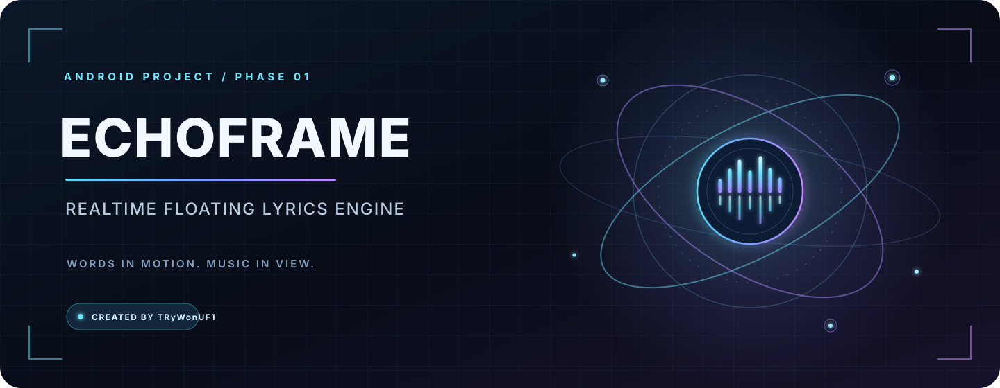

<div align="center">
  <h1>ECHOFRAME</h1>
  <p><b>Realtime Floating Lyrics Engine</b></p>
  <p>PHASE 01 · ANDROID DEMO · CREATED BY TRyWonUF1</p>
  <p><code>MediaSession</code> · <code>Timestamped Lyrics</code> · <code>Touch-through Overlay</code></p>
</div>



---

## Project status

> **PHASE 01 — DEMO / ACTIVE DEVELOPMENT**
>
> ECHOFRAME is an early project build. It is not feature-complete and should be treated as a technical demo. More development phases are planned; the current phase establishes the Android permission flow, media-session listener, lyrics lookup/cache, and floating renderer.

## What ECHOFRAME is

ECHOFRAME is an Android app concept that displays separate lyric phrases as floating text objects over other apps. Phrases choose changing positions, move upward, avoid nearby text objects where possible, and can dissolve in a balloon-pop particle burst. The overlay surface is configured as non-focusable and non-touchable so it does not intentionally consume game taps.

### Phase 01 features

- Animated typewriter welcome screen.
- First-run verification for overlay permission, notification-listener access, and app notifications.
- Optional Shizuku connection check and optional battery-optimization settings shortcut.
- Persistent onboarding state: after the first successful setup, reopening the app returns to the main menu unless app data is cleared.
- Start console with staged initialization messages and a short `LYRICS READY` status.
- Android MediaSession detection for Spotify, YouTube, YouTube Music, and other players that expose usable session metadata.
- LRCLIB lookup for line-timestamped lyrics.
- Plain-lyrics fallback with **estimated** timing when synced timestamps are unavailable.
- Explicit states for instrumental tracks, missing lyrics, and lookup/network errors.
- Room database cache for previously retrieved lyric records.
- Random floating phrase placement, collision avoidance attempts, portrait/landscape resizing, glow, pop particles, and configurable visual controls.
- Vector-drawable app icon: the logo is code/XML, not a bundled PNG/JPG image.
- GitHub Actions workflow to run unit tests, assemble the debug APK, and upload it as an Actions artifact.

## Screens and visual direction

The visual system uses a dark navy surface, cyan/violet accents, a code-drawn orbital mark, a typewriter startup, a terminal-like start sequence, and randomized lyric placement. About screen visuals are drawn by Compose; the app icon is a VectorDrawable. No raster icon pack is included.

## Lyrics accuracy and coverage

ECHOFRAME reads track metadata and playback timing from Android media sessions. It does **not** access another app's private database, scrape its private storage, or record the device audio.

The current lookup provider is [LRCLIB](https://lrclib.net/docs). The app requests a track signature using title, artist, album when available, and duration. A timestamped LRC result is preferred. If only plain lyrics are returned, the app can create evenly spaced estimated timestamps; those are not word-perfect karaoke timing and are identified as estimated in the interface.

No third-party provider guarantees lyrics for every track. A track may be missing, instrumental, incorrectly matched, unavailable offline, rate-limited, or hidden behind an app that does not expose useful media metadata. In those cases ECHOFRAME shows an honest status instead of inventing lyrics. The project can later add a manual track-match flow and additional licensed/compatible lyric providers.

## Permissions explained

| Permission | Required? | Why |
|---|---:|---|
| Display over other apps | Yes | Draws the floating lyrics view over games and other apps. |
| Notification listener access | Yes | Allows Android to expose active media sessions and track metadata. |
| Post notifications | Yes on Android 13+ | Displays the ongoing foreground-service notification. |
| Shizuku | Optional | Integration/status check only in Phase 01; not required by the lyrics engine. |
| Battery optimization settings | Optional | May help background continuity on some devices. |

Shizuku is not used as a shortcut around Android permission screens. The normal Android overlay and notification-listener permissions are still required.

## Build with GitHub Actions (phone-friendly)

1. Create a new GitHub repository and upload the contents of this ZIP to the repository root.
2. Make sure the default branch is named `main` or `master`.
3. Open the repository's **Actions** tab.
4. Enable GitHub Actions if GitHub asks.
5. Run **ECHOFRAME Android CI** with **Run workflow**, or push a commit.
6. Open the completed workflow run and download the artifact named `ECHOFRAME-phase1-debug-apk`.
7. Install the APK on an Android device and grant its required permissions during first run.

The workflow runs `testDebugUnitTest` and `assembleDebug`. The downloadable APK is a **debug build**, not a Play Store release-signed APK.

## Build locally

Use Android Studio with JDK 17 and Android SDK Platform 36 / Build Tools 36.0.0. From the project root, run:

```bash
gradle testDebugUnitTest

gradle assembleDebug
```

The GitHub Actions workflow installs Gradle 8.13 directly. This source ZIP intentionally does not bundle a Gradle wrapper JAR; GitHub Actions is the recommended build path for this Phase 01 handoff.

## Technical structure

```text
app/src/main/java/dev/trywonuf1/echoframe/
├── MainActivity.kt
├── data/
│   ├── AppPrefs.kt
│   ├── EchoDatabase.kt
│   ├── LrcParser.kt
│   └── LyricsRepository.kt
├── media/
│   ├── MediaMonitorService.kt
│   └── PlaybackBus.kt
├── overlay/
│   ├── EchoRuntime.kt
│   ├── LyricsOverlayService.kt
│   └── LyricsOverlayView.kt
└── util/
    └── ShizukuStatus.kt
```

- `MediaMonitorService` is the Android `NotificationListenerService` that observes available media sessions.
- `LyricsRepository` fetches a lyrics record from LRCLIB and stores it in Room.
- `LrcParser` parses line timestamps and provides a separately-labelled plain-text timing fallback.
- `LyricsOverlayService` owns the foreground service and touch-through WindowManager surface.
- `LyricsOverlayView` draws phrases, collision checks, glow, upward motion and particle bursts.
- `AppPrefs` persists onboarding and visual settings.

## Phase 01 limitations

- Lyrics are synchronized at **line level** when LRC timestamps exist. Word-by-word karaoke timing is not implemented yet.
- Plain lyrics use estimated timing and may drift from the actual vocal.
- Media-session metadata quality varies by media app and Android version. Some YouTube playback modes may not expose a session while backgrounded.
- The overlay is touch-through by design, but Android version, OEM software, security policy, and game rendering can affect touch behavior. Verify on the target device.
- Collision avoidance uses screen-space estimates; very long text, unusual display scaling, or rapid song changes can still produce crowded moments.
- The app must be started by the user. Battery/autostart behavior differs by manufacturer.
- The optional Shizuku connection does not unlock lyrics or bypass provider coverage.

## Planned next phases

- Word-level timestamp rendering when a provider supplies word timing.
- Manual track matching and a better wrong-match correction flow.
- More licensed/compatible lyric sources with provider attribution.
- Additional source-app compatibility checks and playback diagnostics.
- Expanded visual presets, text motion curves, burst styles, and performance profiles.
- Device-specific background guidance and an expanded automated test suite.

## Credits and references

- Android `MediaSessionManager` / `NotificationListenerService` documentation.
- Android overlay permission and foreground-service documentation.
- LRCLIB API documentation: https://lrclib.net/docs
- Shizuku API documentation: https://github.com/RikkaApps/Shizuku-API

Created by **TRyWonUF1**. ECHOFRAME is an independent demo project and is not affiliated with Spotify, YouTube, Google, or LRCLIB.
